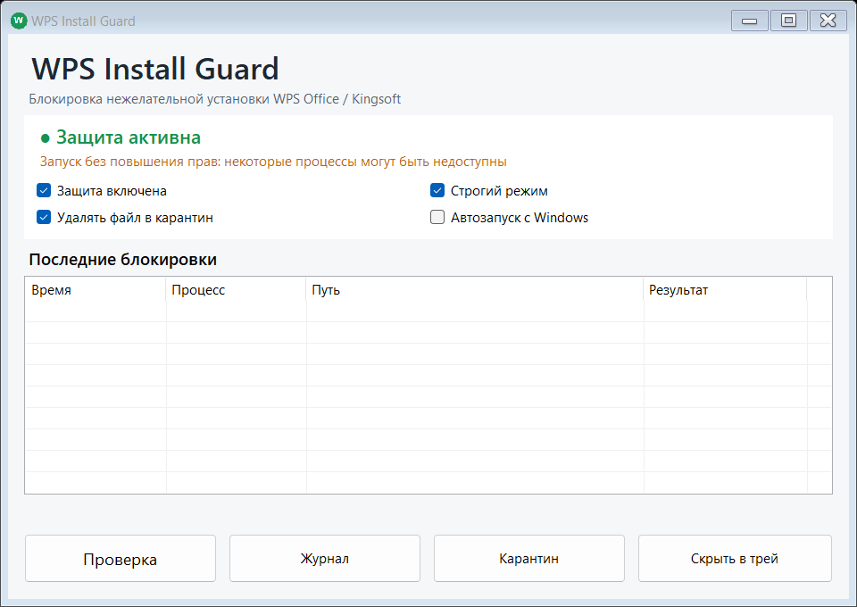
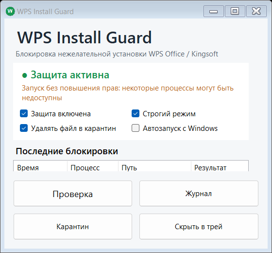

# 🛡️ WPS Install Guard

### WPS снова появился без приглашения? Возьми установку под контроль.

Небольшая программа для **Windows 11 Home**, которая следит за запуском WPS Office / Kingsoft, останавливает обнаруженные процессы и показывает уведомление с путём к файлу. Управление — через значок в трее. Подтверждённый EXE можно автоматически убирать в восстанавливаемый карантин.

**[Скачать EXE](https://github.com/login34245/wps-install-guard/releases/latest/download/WpsInstallGuard.exe)** · **[Скачать ZIP с инструкцией](https://github.com/login34245/wps-install-guard/releases/latest/download/WpsInstallGuard-v1.2.0-win.zip)** · [Все релизы](https://github.com/login34245/wps-install-guard/releases) · [Сообщить о проблеме](https://github.com/login34245/wps-install-guard/issues)



## Что умеет

- Останавливает обнаруженный процесс WPS / Kingsoft и его дерево дочерних процессов.
- Показывает уведомления о запуске защиты и блокировке, сохраняет исходный путь в журнал.
- Перемещает подходящий EXE в карантин с расширением `.blocked`.
- Работает в трее: левый клик открывает окно, правый — меню управления.
- Поддерживает автозапуск с повышенными правами через Планировщик заданий.
- В строгом режиме блокирует также компоненты и приложения WPS / Kingsoft.
- Масштабирует нижние кнопки по DPI монитора и перестраивает их в несколько рядов.
- Позволяет проверить перехват безопасным имитатором установщика.

## Быстрый запуск

1. Скачай `WpsInstallGuard.exe` из [последнего релиза](https://github.com/login34245/wps-install-guard/releases/latest).
2. Положи файл в постоянную папку и запусти. Программа попросит права администратора через UAC.
3. После уведомления найди зелёный значок **W** в трее. Windows может спрятать его под стрелкой рядом с часами.
4. Открой окно левым кликом. При необходимости включи «Автозапуск с Windows» и нажми «Проверка».

Отдельный установщик не нужен. Используется .NET Framework 4.8, доступный в штатных установках Windows 11. EXE не подписан сертификатом: в запросе UAC издатель будет указан как неизвестный. Для проверки скачанного файла в релиз приложен `SHA256SUMS.txt`.

## Кнопки, которые помещаются на экране

В версии **1.2.0** нижняя панель получила собственный расчёт размеров: кнопки имеют высоту не меньше 44 логических пикселей, увеличенный текст и отступы с учётом DPI. На широком окне они идут в один ряд, на узком — в несколько. Панель резервирует нужную высоту; при нехватке места верхняя часть окна прокручивается, а кнопки остаются видимыми.



## Как работает карантин

Опция «Удалять файл в карантин» включена по умолчанию. После остановки найденного процесса программа пытается убрать его EXE из исходной папки в:

```text
%LOCALAPPDATA%\WpsInstallGuard\Quarantine
```

Файл получает расширение `.blocked`, а новый и исходный пути записываются в журнал. Если перемещение не удалось, причина также сохраняется. Для просмотра файлов есть кнопка «Карантин» и пункт «Открыть карантин» в меню трея.

Системные файлы из папки Windows и сама программа защищены от перемещения. Если WPS упомянут только в аргументах системной обёртки, например `cmd.exe` или `msiexec.exe`, её процесс может быть остановлен, но собственный EXE обёртки не отправляется в карантин.

При ложном срабатывании сначала выключи защиту. Затем верни сохранённый файл в исходную папку и восстанови имя без префикса карантина и расширения `.blocked`. Исходный путь можно найти в журнале. Это ручное восстановление: программа не запускает сохранённые файлы сама.

## Автозапуск и обновление

Опция «Автозапуск с Windows» создаёт задание `WPS Install Guard` в Планировщике заданий с запуском при входе и наивысшими правами.

Для обновления выбери «Выход» в меню трея, замени EXE новым файлом **в той же папке** и запусти его. При сохранении пути задание автозапуска менять не нужно. Для переноса программы сначала выключи автозапуск, перенеси EXE и включи опцию заново.

## Проверка без установки WPS и 360

Кнопка «Проверка» создаёт во временной папке копию системного компонента с тестовым именем установщика WPS. Он запускается в скрытом режиме, после чего защита должна его остановить. Тестовые копии автоматически очищаются.

Перед публикацией прошли:

- **7 проверок** распознавания процессов, включая защиту системных обёрток от перемещения в карантин;
- **сквозной тест** остановки безопасного имитатора установщика;
- **проверки окон** 560×520, 720×560 и 960×680;
- **32 проверки нижней панели**: размеры кнопок, размещение, отсутствие пересечений и обрезания текста при расчётном масштабе 100–300% и возврате к 100%.

Дополнительные значения DPI моделируются без изменения настроек дисплея. Реальная автоустановка из 360 Total Security в этих тестах не использовалась.

## Что важно знать

Программа реагирует **после запуска процесса** через WMI, а при недоступности подписки использует опрос новых процессов. Это не драйвер ядра и не гарантия, что установщик не успеет выполнить ни одного действия.

Распознавание использует имя, путь, метаданные и сведения о подписи файла. Возможны пропуски и ложные срабатывания; строгий режим блокирует также уже установленный WPS и другие распознанные компоненты Kingsoft. Программа не заменяет антивирус и не удаляет целиком установленный офисный пакет.

Журнал содержит локальные пути и хранится только на компьютере. Программа не отправляет телеметрию и не загружает установщики из сети.

## Файлы пользователя

```text
%LOCALAPPDATA%\WpsInstallGuard\
├── blocked.log      — история блокировок и ошибок
├── config.ini       — настройки защиты
└── Quarantine\      — сохранённые EXE с расширением .blocked
```

Перед публикацией журнала в issue скрывай имя пользователя и другие личные сведения в путях.

## Сборка из исходников

Потребуется Windows с .NET Framework 4.8 и стандартным компилятором `csc.exe`. Сторонние библиотеки и пакеты NuGet не используются.

```powershell
powershell -ExecutionPolicy Bypass -File .\build.ps1
```

Скрипт собирает релиз, выполняет проверки и оставляет `dist\WpsInstallGuard.exe`. Тестовый EXE и временные данные удаляются.

Основные файлы: [исходный код](WpsInstallGuard.cs), [сценарий сборки](build.ps1), [манифест прав и DPI](app.manifest), [история изменений](CHANGELOG.md).

## Обратная связь

Открой [issue](https://github.com/login34245/wps-install-guard/issues/new/choose) и укажи версию программы, размер экрана, масштаб Windows и шаги, при которых возникла проблема. Для ошибок интерфейса пригодится скриншот; для ошибок перехвата — обезличенная строка из журнала.

Проект независимый и не связан с разработчиками WPS Office, Kingsoft или 360 Total Security.
